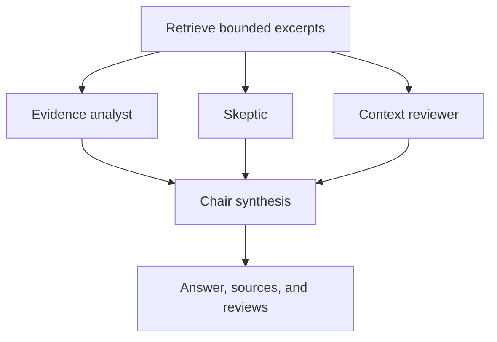

# Council and interface decisions

## Evidence council

The project uses a fixed, bounded council rather than open-ended agent-to-agent debate.
All reviewers see the same retrieved, budgeted excerpt snapshot with stable citation numbers.
They receive different tasks and do not see each other's initial findings. The chair receives
both the original excerpts and up to 3,000 characters per review, and is instructed to resolve
claims against sources, disclose material disagreement, and abstain when evidence is missing.

This is application-level multi-agent orchestration with role-specific evidence focus, not
learned attention weights or a change to the underlying model. It uses LangChain chat
runnables and a standard-library executor, avoiding an additional graph runtime for this
small fixed workflow. LangChain's custom workflow documentation describes the same general
retrieve / parallel processing / synthesis composition; this implementation does not claim
to use LangGraph.

- Single is the default and makes one logical model call; Council makes up to four.
- Each production chat client has a 60-second request timeout, two retries, and a 2,048-token
  output ceiling. Retries can increase actual request counts and elapsed time. There is no
  separate overall council deadline; it waits for the bounded provider attempts to finish.
- No model is called if no evidence fits. Retrieval runs once before reviewers start.
- At least two reviewers must complete. One failure is shown with a warning; two failures
  stop synthesis and leave the previous answers intact. There is no hidden single fallback.
- Unknown numeric source IDs reject a review or synthesis. An uncited final answer is
  withheld and replaced by an abstention. These are citation-integrity checks, not semantic
  fact verification: a valid citation can still fail to support a claim.
- All roles currently use the configured Gemini model with distinct prompts. This is not
  model diversity, independent corroboration, calibrated confidence, or majority voting.
- Prompt instructions treat excerpts and reviewer notes as untrusted. They reduce risk but
  do not constitute a complete prompt-injection defense.

## Interface

Use a quiet dark document workspace with mint accents, readable answer cards, a persistent
library sidebar, explicit Single/Council selection, visible progress, and separate source
and review tabs. Keep the main task focused on asking questions and checking evidence.
Questions remain independent; the conversation is display history, not model memory.

SweetAlert2 is reserved for rebuilding embeddings and clearing the conversation. Indexing
completion uses a nonblocking toast, and failures use inline errors. The locally bundled,
version-pinned SweetAlert2 component returns a confirmation value to Python; merely opening
or cancelling the popup cannot perform an action. Popups render in an isolated
Streamlit iframe inside a centered native dialog, rather than manipulating the parent page.
Focus defaults to Cancel, keyboard dismissal works, and reduced motion is respected.

The vendor script and MIT license are included in Python package data, so these popups do
not fetch a CDN at runtime. Source: SweetAlert2 11.26.3 from jsDelivr's npm distribution.

## Research references

- [LangChain custom workflows](https://docs.langchain.com/oss/python/langchain/multi-agent/custom-workflow): controlled sequential and parallel flows; retrieve then synthesize.
- [Carbon modal guidance](https://v10.carbondesignsystem.com/components/modal/usage/): confirmations should explain consequences; routine status should use less disruptive feedback.
- [Carbon for AI](https://www.carbondesignsystem.com/building-blocks/foundations/carbon-for-ai): make AI-generated content and explainability visible.
- [SweetAlert2](https://sweetalert2.github.io/): accessible confirmation dialogs.
- [Streamlit custom components](https://docs.streamlit.io/develop/concepts/custom-components/components-v1/intro): isolated bidirectional Python/JavaScript communication.

## Validation scope

Automated tests use deterministic embeddings and fake chat responses. They exercise real
Chroma persistence, parallel review scheduling, source/citation handling, partial failures,
CLI JSON, and the Streamlit interaction flow without sending documents to an external model.
A real Gemini answer-quality, quota, latency, and cost evaluation still needs a configured
API key and a representative question set. Compare Single and Council against the same
human-checked expected answers before claiming a quality improvement.

The desktop workspace, council tabs, centered confirmation (Cancel focus, Cancel preservation,
and Confirm action), and rebuild flow were also exercised in Chromium with offline model
fixtures. These screenshots illustrate layout and interactions, not real Gemini answer quality:

- [Workspace](workspace.png)
- [Council reviews](council.png)
- [SweetAlert2 confirmation](popup.png)
- [Mobile workspace](mobile.png)
